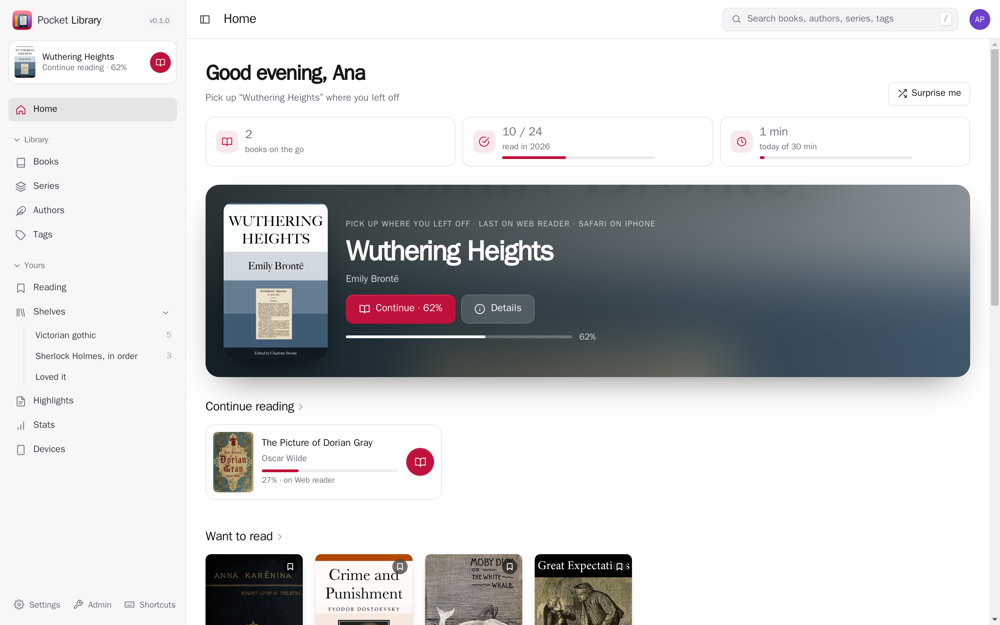
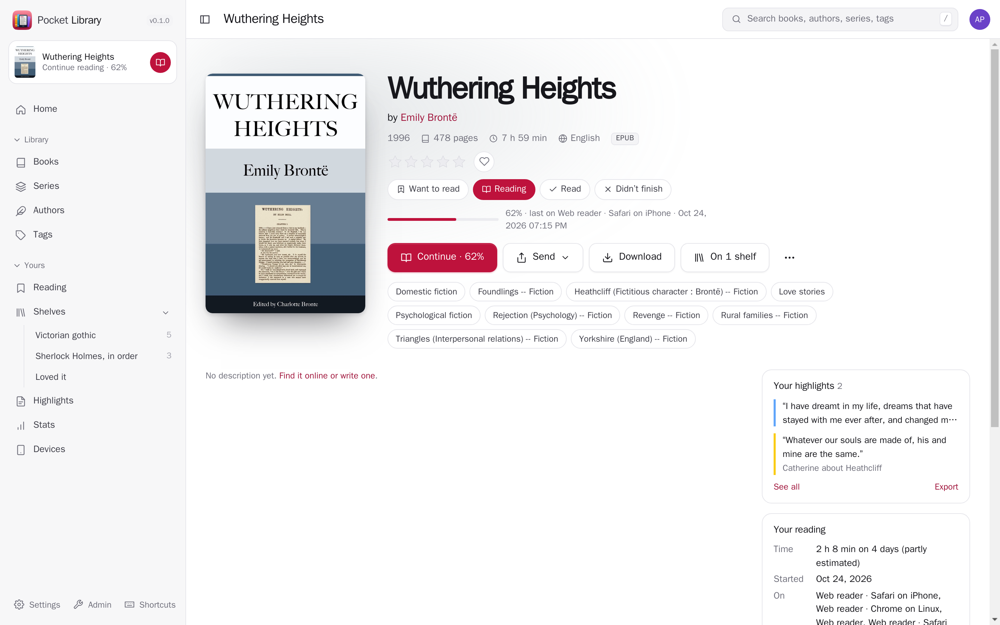
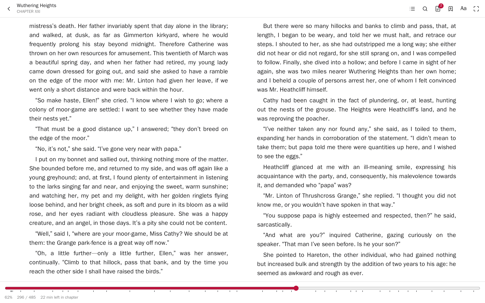
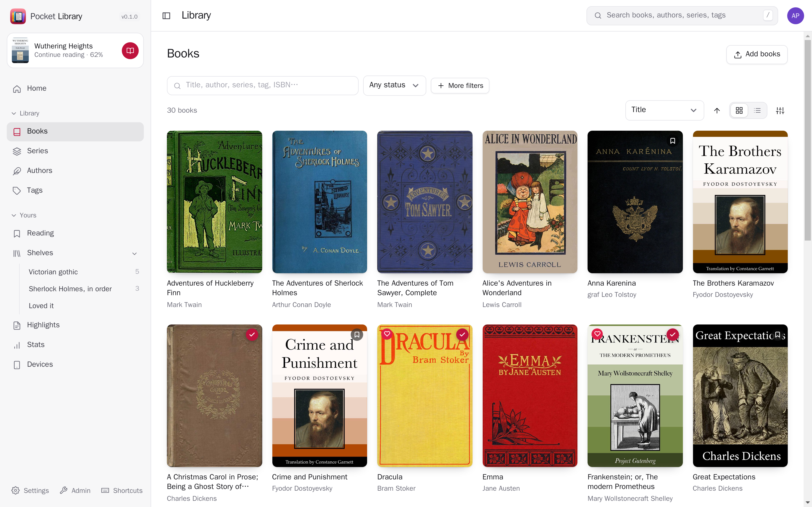
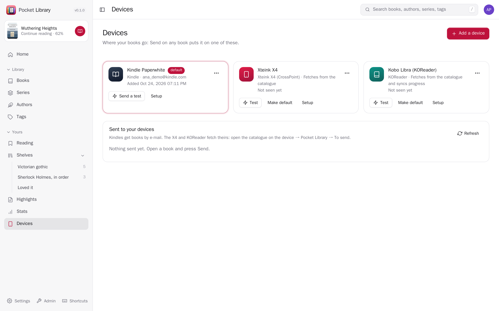
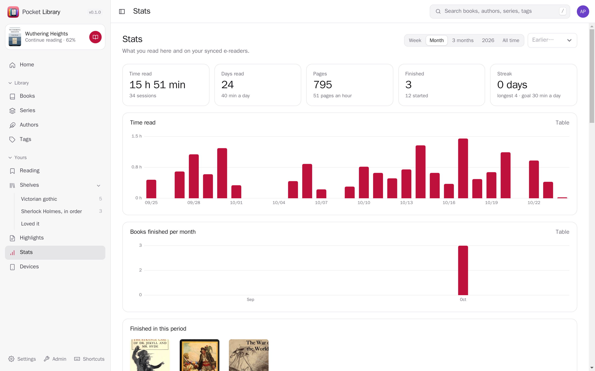
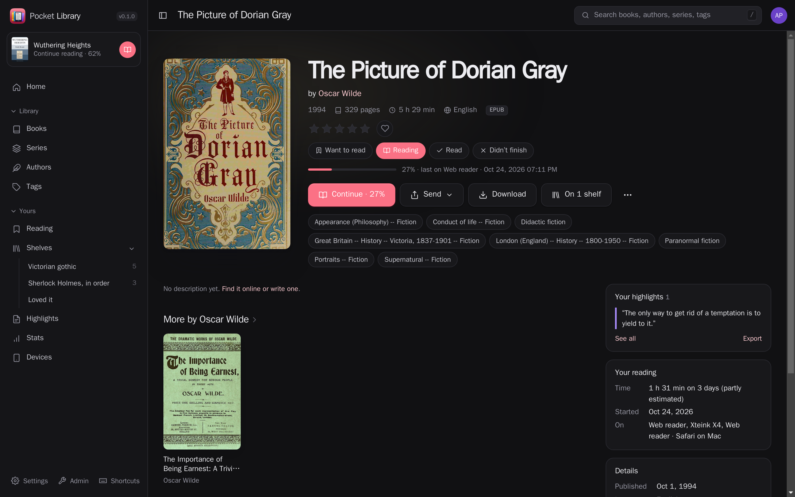
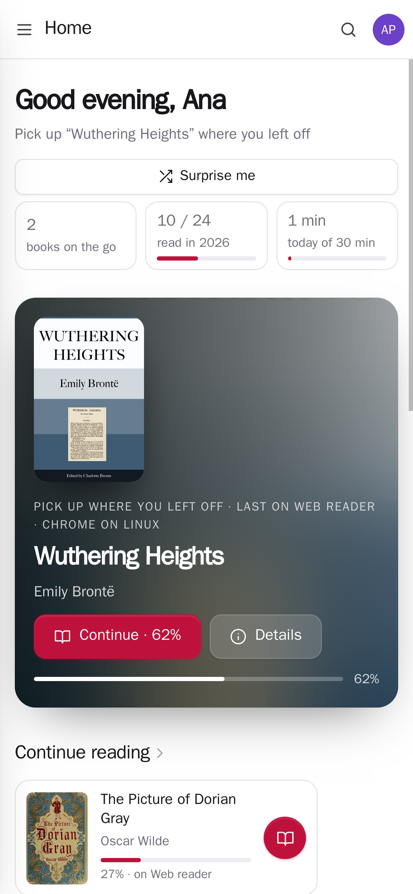
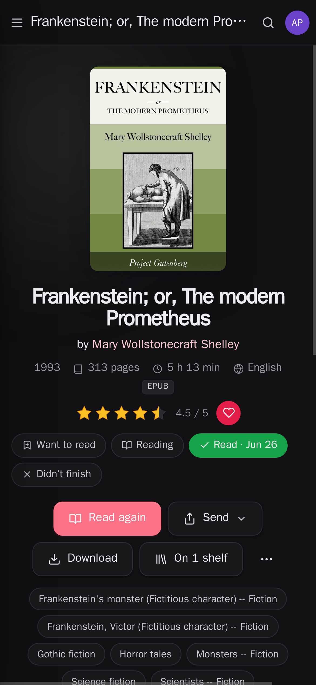

<p align="center"></p>
<h1 align="center">Pocket Library</h1>
<p align="center">Every ebook, comic and manga you own, in one place: a library that files and fixes your books, a reader for EPUB, MOBI, PDF, comics and manga in the browser, your place kept in step with KOReader and the Xteink X4, and a Send button for your Kindle and e-readers.<br>One Go binary, one SQLite file, your book folders.</p>
<p align="center">
  <a href="https://github.com/abjelosevic88/pocket-homelab-library/actions"></a>
  <a href="https://github.com/abjelosevic88/pocket-homelab-library/pkgs/container/pocket-homelab-library"></a>
  <a href="LICENSE"></a>
</p>

---

<p align="center"></p>

<table>
  <tr>
    <td width="50%"></td>
    <td width="50%"></td>
  </tr>
  <tr>
    <td align="center"><sub>Every book: your status and rating, Send to a device, every format to download, highlights and time read.</sub></td>
    <td align="center"><sub>A calm reader for EPUB, MOBI, AZW3 and FB2, with chapters, search, highlights and notes.</sub></td>
  </tr>
  <tr>
    <td width="50%"></td>
    <td width="50%"></td>
  </tr>
  <tr>
    <td align="center"><sub>Filters, sorting, multi-select and bulk edits over thousands of books.</sub></td>
    <td align="center"><sub>Your Kindle, Xteink X4 and KOReader devices, and what was sent where.</sub></td>
  </tr>
  <tr>
    <td width="50%"></td>
    <td width="50%"></td>
  </tr>
  <tr>
    <td align="center"><sub>Time read on every device, pages, streaks and finished books.</sub></td>
    <td align="center"><sub>Dark mode.</sub></td>
  </tr>
</table>

<p align="center">
  &nbsp;&nbsp;
  &nbsp;&nbsp;
  
</p>

## What it does

**Your folders, kept tidy**
- Point it at your book folders: books, comics and manga libraries, each open to everyone or to chosen people.
  The EPUB, MOBI and PDF of one book become one book with three formats; Calibre's sidecar `.opf` files and
  one-folder-per-book layouts are read as they are. Ten thousand books scan in a couple of minutes, and rescans
  only open what changed.
- Edit everything (title, authors, series, tags, language, identifiers, cover) one book at a time or in bulk;
  edited fields are locked so a rescan never undoes them. Fetch details and covers from Open Library and Google
  Books, field by field, or fill in what is missing across the whole library.
- Upload in the browser or drop files into an ingest folder: they are filed as `Author/Author - Title.ext`.
  Duplicates found by file, ISBN and title; author pages with photos and biographies.

**Read anywhere**
- A reader in the browser for EPUB, KEPUB, MOBI, AZW3, FB2, PDF, CBZ, CBR and CB7: pages or scrolling, fonts,
  sizes, margins, sepia and dark themes, contents, search, footnotes, bookmarks, highlights in five colours with
  notes, dictionary look-ups. Comics single or two pages at a time, manga right to left, webtoons as one strip.
- Your place follows you: the web reader, KOReader and the **Xteink X4 with CrossPoint** all sync to the
  built-in KOReader sync server, matched to the exact file even when the device's copy has another name, and a
  device opening a book you read further elsewhere jumps to that page.
- An **OPDS catalogue** for KOReader, CrossPoint and any OPDS app: continue reading, want to read, recently
  added, your shelves, authors, series, search, and what you sent to that device.
- A **KOReader plugin** (also for a jailbroken Kindle): downloads books you sent, uploads highlights and reading
  time, and sets up sync and the catalogue in one tap.

**Send it**
- **Send to Kindle** by e-mail with Amazon's EPUB fixes and your edited metadata written in; MOBI and AZW3
  converted to EPUB first (calibre). Also to any e-mail device, straight to an X4 on your network, or into a
  device's catalogue to fetch later. Downloads in any format, converted on the way (EPUB, KEPUB, AZW3, …).

**Yours**
- Want to read, reading, read (with dates, re-reads count), didn't finish; half-star ratings; favourites.
- Shelves: hand-picked, ordered reading lists, and smart shelves that fill themselves from a filter.
- Highlights from every device in one place, searchable, exported as Markdown.
- Stats: time read per day and device, pages, streaks, daily and yearly goals, books finished.
- Everything you do is yours alone; admins manage the library, not your reading.

**Moving in**
- Import from Calibre-Web (Kindle addresses, the mail account, shelves, read status) and Kavita (progress,
  ratings, collections, reading lists), and your Kindle's `My Clippings.txt`.

**With the other Pocket apps**
- Sign in with Pocket Core; Pocket Bookshelf turns what you finish here into reads, the page you are on into
  progress and your highlights into quotes; your rating there shows here; events (started, finished, highlighted, sent) for anything else.

## Run it

```sh
docker run -d --name pocket-library -p 8080:8080 -v ./data:/data -v /path/to/books:/books \
  -e BASE_URL=https://library.example.com -e SECURE_COOKIES=true -e LIBRARIES="Books=/books" \
  ghcr.io/abjelosevic88/pocket-homelab-library:latest        # :latest-calibre adds conversions
```

Open it, create the first account, and add your e-readers under Devices; each shows what to type in. See
[docs/configuration.md](docs/configuration.md) for every option, [docs/api.md](docs/api.md) for the API and the
e-reader endpoints, [docs/design.md](docs/design.md) for how it works, [docs/backup.md](docs/backup.md) and
[docs/reverse-proxy.md](docs/reverse-proxy.md).

Try it with public-domain books: `scripts/demo/make.sh`, then
`make web build && DATA_DIR=/tmp/pl AUTH_MODE=none LIBRARIES="Books=$HOME/.cache/pocket-library-demo/books" ./pocket-library`.

## Built with

Go, chi, SQLite (modernc, FTS5), React 19, Vite, [foliate-js](https://github.com/johnfactotum/foliate-js) and
pdf.js for reading, kepubify, calibre for conversions. Part of the Pocket apps; works alone, and with
[Pocket Core](https://github.com/abjelosevic88/pocket-homelab-core) for single sign-on, paired phones and the links
between apps. MIT licensed.
